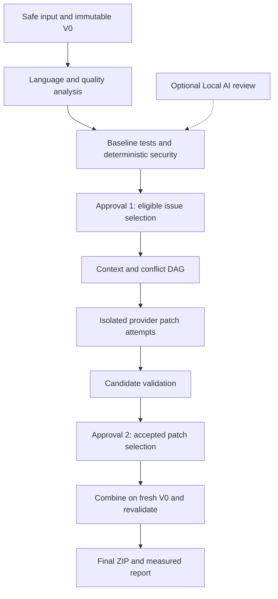

# Architecture and safety contracts

This is the intended architecture, not a list of delivered capabilities. Sources: master system architecture, step-by-step development guide and approved five-person work-package plan. The course deadline and account confirmations supersede the older relative 12-week schedule. Private source PDFs/DOCX are not republished.

| Component | Responsible runtime module | Contract/output |
|---|---|---|
| FastAPI orchestrator, state/queue, storage | Core API and workers | Runs, consent, immutable versions, idempotent jobs |
| Language Router and adapters | Language adapters | Per-component language capabilities, symbols, source locations, uncertainty |
| Quality and deterministic security tools | Quality/SAST workers | Normalized findings with real evidence and stable rule/tool versions |
| Mandatory first-delivery Falcon-Mamba 7B local review | Isolated Local AI service | Evidence-labelled review, bounded inference, explicit fallback |
| Context builder, conflict DAG, providers | Context/patch orchestration | Bounded masked context, isolated patch attempts, conservative scheduling |
| Sandbox, candidate and final validation | Validation workers | Frozen tests, regression/security results, independent behavior/quality outcomes |
| React/TypeScript/Monaco and reporting | User interface and reporting service | Two approvals, diff, evidence-linked measurements/history |

The two approvals are product decisions; an independent GitHub PR review is a separate development control. A model's security claim is unconfirmed until supported by tool/test/independent evidence. Security findings do not silently become eligible quality-refactoring tasks.

V0 and frozen test hashes must remain unchanged. Patches cannot edit tests or weaken rules; candidate workspaces and final combination are distinct. At most one initial patch plus two correction attempts; provider network retries are a separate budget. Unknown symbol/side-effect relationships serialize conservatively. Max parallelism is bounded, with planned acceptance of three genuinely independent tasks.

`behavior_status` (PASSED/FAILED/UNVERIFIED) is independent from quality outcome. Build success alone does not establish behavior preservation. Individually passing patches still require a full combined build/regression/static/security validation. Failed attempts remain in denominators; zero denominators display N/A.

P0 first delivery includes Java 21/Maven/JavaParser/PMD/CPD, Python AST/LibCST and pytest/coverage.py, TypeScript API/ts-morph with ESLint and Jest/Vitest, deterministic security plus real Falcon-Mamba 7B local review, HTML/PDF/history. Implementation is dependency ordered, with Java pilot first, but all are required for first delivery. Capabilities and coverage remain per language/component; unresolved cross-service contracts remain uncertain.

Real local Falcon-Mamba 7B is **mandatory P0**. Its exact model revision, runtime, GPU access, memory, compatibility and latency must be measured in #19. A desktop RTX 4090 or M3 ownership is not proof of an accessible compatible deployment. M3 does not supply CUDA. Neither model feasibility nor paid API budget has been verified. Falcon-Mamba is mandatory for the first delivery by the 2026-10-26 owner decision; unavailability blocks release readiness, but deterministic security scans must fail safely and continue.

## Development governance boundary (approved 2026-10-26)

The component labels above are *technical runtime responsibilities*, never permanent human task assignments. PROJECT GENESIS v2.0 authorizes one active developer at a time: Burkay → Cafer → Alperen Enes Yaman → İsmail → Taha Uğur Toyran → repeat. No implementation handoff is accepted without human-reviewed Git publication and orchestrator acceptance. [TR SRS](SRS.md) / [EN SRS](SRS_EN.md) are review drafts pending final owner approval. PR #38 is legacy pre-Genesis preparation, not a completed rotation turn.

## Developer rotation is distinct from module expertise

2026-10-26 owner decision: Burkay → Cafer → Alperen Enes Yaman → İsmail → Taha Uğur Toyran → Burkay. The expertise column does **not** preassign task ownership. The orchestrator selects one ready task and owner at a time. PR #38 predates the rotation and requires independent review plus separate owner merge authorization. Refer to [SRS Türkçe](SRS.md) and [SRS English](SRS_EN.md) review drafts.

## Seven mandatory language adapters — approved 2026-10-27

The first-delivery language set is **Java, Python, JavaScript, TypeScript, C#, Go and C++**, all P0, together with real local Falcon-Mamba 7B. Previous `future C#/Go/C++` statements are superseded. The existing LanguageAdapter/CIR, immutable V0, evidence registry, isolated runtime and patch/combined-validation boundaries remain unchanged; do **not** introduce a parallel refactoring pipeline.

- C# F14-CS (#40): Roslyn/.NET SDK for AST, symbol/dependency references and source ranges; real xUnit/NUnit/MSTest or compatible tests and coverage; isolated build/patch verification.
- Go F14-GO (#41): go/parser/go/types, modules/workspaces, go test/coverage, appropriate static rules and safe source patch evidence.
- C++ F14-CPP (#42): Clang AST/clang-tidy, real compilation database and compiler flags, native build/test/coverage in restricted sandbox; absent headers/compile context must yield UNVERIFIED.

The 34-task, 69-dependency *planned* graph contains required join gates F14-MIX (#34) and F15-P0 (#35). Only the original 54 native GitHub edges are currently established; new issue parent/dependency links are **PENDING_SAFE_SYNC**. The expanded scope does not change the fixed developer rotation, PR #38 reviewer independence or owner-controlled merge authorization. Burkay is technical lead/audit coordinator for PR #38; this does not rewrite Cafer's GitHub PR authorship or waive independent review.

## Mandatory seven-language first-delivery architecture — 2026-10-27

Owner-approved P0: Java, Python, JavaScript, TypeScript, C# (Roslyn/.NET), Go (module-aware parser/types) and C++ (Clang/compilation database) are **all required working adapters**, together with real Falcon-Mamba 7B, two user approval gates, isolated original/frozen-test patch validation and HTML/PDF/ZIP/history. Older language-extension text is superseded by this decision.

F14-CS (#40), F14-GO (#41) and F14-CPP (#42) depend on F02-CONTRACT, F06-SANDBOX and F11-VALIDATE. Each must report real parse/symbol/quality/build/test/coverage and safe-patch validation evidence, plus a negative regression case; missing toolchains are UNVERIFIED, not passing. F14-MIX (#34) depends on all new adapters as well as Python and JS/TS; F15-P0 (#35) depends on F14-MIX, F07B-LOCAL and F13-ADV. Original 31 tasks/54 edges are retained; the 34-task/69-edge **planned** graph awaits native GitHub synchronization. See [SRS TR](SRS.md) and [SRS EN](SRS_EN.md).
