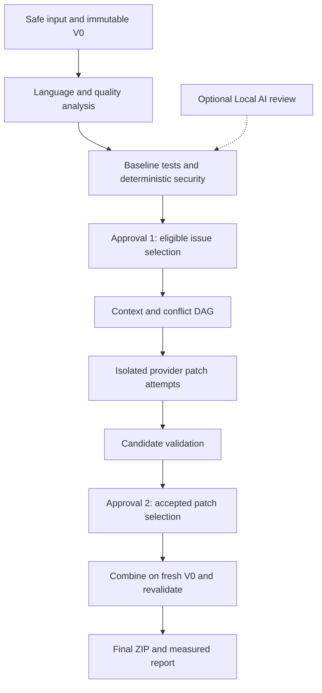

# Architecture and safety contracts

This is the intended architecture, not a list of delivered capabilities. Sources: master system architecture, step-by-step development guide and approved five-person work-package plan. The course deadline and account confirmations supersede the older relative 12-week schedule. Private source PDFs/DOCX are not republished.

| Component | Owner | Contract/output |
|---|---|---|
| FastAPI orchestrator, state/queue, storage | Cafer | Runs, consent, immutable versions, idempotent jobs |
| Language Router and adapters | Burkay | Per-component language capabilities, symbols, source locations, uncertainty |
| Quality and deterministic security tools | Burkay | Normalized findings with real evidence and stable rule/tool versions |
| Optional Local AI service | Alperen | Evidence-labelled review, bounded inference, explicit fallback |
| Context builder, conflict DAG, providers | Alperen | Bounded masked context, isolated patch attempts, conservative scheduling |
| Sandbox, candidate and final validation | İsmail | Frozen tests, regression/security results, independent behavior/quality outcomes |
| React/TypeScript/Monaco and reporting | Taha | Two approvals, diff, evidence-linked measurements/history |

The two approvals are product decisions; an independent GitHub PR review is a separate development control. A model's security claim is unconfirmed until supported by tool/test/independent evidence. Security findings do not silently become eligible quality-refactoring tasks.

V0 and frozen test hashes must remain unchanged. Patches cannot edit tests or weaken rules; candidate workspaces and final combination are distinct. At most one initial patch plus two correction attempts; provider network retries are a separate budget. Unknown symbol/side-effect relationships serialize conservatively. Max parallelism is bounded, with planned acceptance of three genuinely independent tasks.

`behavior_status` (PASSED/FAILED/UNVERIFIED) is independent from quality outcome. Build success alone does not establish behavior preservation. Individually passing patches still require a full combined build/regression/static/security validation. Failed attempts remain in denominators; zero denominators display N/A.

P0 uses Java 21/Maven pilot, JavaParser/PMD/CPD plus deterministic security tooling selected and pinned in its task. Python AST/LibCST, pytest/coverage.py and TypeScript API/ts-morph, ESLint, Vitest/Jest are P1 adapter plans. Capabilities and coverage remain per language/component; unresolved cross-service contracts remain uncertain.

Falcon-Mamba runtime/model revision, actual GPU access, memory, compatibility and latency must be measured in #19. A desktop RTX 4090 or M3 ownership is not proof of an accessible compatible deployment. M3 does not supply CUDA. Neither model feasibility nor paid API budget has been verified; these resource gates stay visible.
