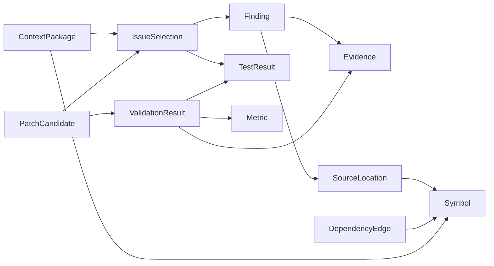

# Contract semantics and compatibility

## Identity and source binding

The canonical schema ID is `urn:genesis:cir:1.0.0`. Each definition's schema ID is
that URI plus `#/$defs/Name`, for example `urn:genesis:cir:1.0.0#/$defs/Finding`.
These are logical identifiers, not deployed URLs. Purpose, field types, required
fields, nullability, enums and domain constraints appear in the generated
[data dictionary](DATA-DICTIONARY.md) and JSON Schema.

Every wire field is required in v1. Nullable fields are supplied explicitly as
null. Unknown confidence/tool versions/model revisions/settings/measurements
require an explanation; null never implies zero, false, clean or unsupported.
Unknown object fields and unsupported schema versions are rejected.

IDs use `type:opaque-slug`, with the exact ASCII syntax in the schema. Record
prefixes are location, symbol, dependency, evidence, finding, metric, test,
capability, adaptercaps, selection, context, patch and validation. Inventory
prefixes are file, artifact, suite and attempt; scope references use project,
version, analysis and run. Actor, approval, component, adapter, job, case and
request identifiers have their corresponding prefixes. IDs are globally unique
within a bundle and immutable within the recorded analysis. Producers preserve
an ID when serving the same record again. Repeat analyses use fresh analysis/run
IDs and do not silently reuse approvals; consumers must compare complete scope,
not an opaque slug alone. Correlation across runs is not automatic acceptance.

`scope` binds the immutable project version, Git revision, baseline manifest,
analysis and run. `subject_sha256` identifies the actual source-manifest snapshot
observed by a record. Baseline tests and candidate tests have different subjects
even when their suite hash is the same. A test/scanner/metric result for V0 cannot
prove anything about changed candidate bytes. Validation requires the observed
test, scan and metric subjects to match its workspace manifest and candidate.

Git object SHA-1, source-manifest SHA-256, file-byte SHA-256, frozen-suite manifest
SHA-256, configuration/comparison fingerprints and diff-byte SHA-256 are distinct
fields. No field contains its own enclosing file's hash. Future Git SHA-256
repositories require an explicitly versioned contract change.

## Coordinates and portable paths

- Lines and columns are **1-based**. Start is inclusive; end is exclusive.
- A column counts Unicode scalar values, not UTF-8 bytes or UTF-16 code units.
  An astral emoji and a tab each occupy one scalar column, regardless of display
  width. LF and CRLF each separate one logical line; raw bytes are never normalized.
- Resolved ranges have all source identity/coordinate fields and a strictly later
  end. Unresolved ranges have null coordinates and an explicit reason.
- `source_offsets` optionally checks UTF-8 source bytes, their file hash, line
  bounds and scalar-column bounds. It rejects standalone CR and invalid UTF-8;
  an adapter must return unresolved rather than guessing a translation.
- Paths are NFC repository-relative names with forward slashes. Reject absolute
  paths, drive/UNC syntax, traversal, empty segments, percent encoding, backslashes,
  controls, `.git`, Windows device names and trailing dots/spaces. Do not rewrite
  a path or decode it silently. The manifest disallows same-snapshot case-folded
  collisions. These rules do not replace filesystem symlink/race checks at apply.
- External byte/UTF-16 parsers and Monaco clients must convert explicitly at their
  boundary using the actual source bytes. No adapter may label native byte/UTF-16
  coordinates as scalar coordinates.

## Provenance and outcome dimensions

Finding classification is QUALITY_REFACTOR, SECURITY_REVIEW or BASELINE. Only
current, open, resolved and independently evidenced eligible quality findings
enter ordinary Gate 1. SECURITY_REVIEW never silently becomes quality work.

Evidence retains its producer kind, tool/version/config, rule or model provenance,
source snapshot, artifact integrity, source/symbol references, verification,
confidence and redaction. An LLM claim remains UNCONFIRMED; corroboration is a
separate independently VERIFIED evidence record. Unknown model settings or
Falcon-Mamba revision are not filled with invented defaults. Provider settings
must not contain credential fields. Actual secret scanning/masking and artifact
authorization are later runtime responsibilities; metadata declarations are not
proof that raw content is safe to send.

| Dimension | Values / meaning |
|---|---|
| Execution | COMPLETED, FAILED, NOT_RUN, UNAVAILABLE, INCOMPLETE |
| Behavior | PASSED, FAILED, UNVERIFIED; actual nonempty, unskipped snapshot-matched tests are needed for PASSED |
| Quality | IMPROVED, UNCHANGED, WORSE, NOT_COMPARABLE; never inferred from a test/build exit |
| Security | CLEAN, FINDINGS, NOT_RUN, UNAVAILABLE, INCOMPLETE; success needs completed independent scan evidence |
| Evidence | VERIFIED, UNCONFIRMED, REJECTED, UNAVAILABLE |
| Adapter delivery | CONTRACT_DEFINED versus RUNTIME_IMPLEMENTED, independently of each individual operation |

PASSED+IMPROVED, PASSED+UNCHANGED and PASSED+WORSE are valid independent outcomes;
UNVERIFIED+NOT_COMPARABLE is also valid with explicit reasons. APPLICABLE describes
patch metadata applicability. It is not user approval, an acceptable quality
result, proof of behavior preservation, or eligibility for a final export.
Future Gate 2 must apply the approved product acceptance policy to actual results.

Comparable quality metrics have the same name, unit, direction and comparison
fingerprint, with a BASELINE and CANDIDATE observation on the right snapshots.
The comparison context exposes actual tool/version/config, ruleset version,
measurement-scope fingerprint, environment fingerprint and applicable frozen
suite. `comparison_key` is checked as JCS/SHA-256 of `{name, unit, currency_code,
direction, comparison}`; it cannot conceal different tools behind an opaque key.
Missing tool/config/ruleset/environment or unknown suite context prevents a
comparable quality claim. Provenance may retain UNCONFIRMED model annotations
alongside independent proof, but they never satisfy a verification requirement.
Any worsened pair makes the reported comparison WORSE; otherwise an improved pair
makes it IMPROVED; all equal is UNCHANGED. Unknown/contextual/incomplete inputs
cannot support those claims and remain NOT_COMPARABLE. Counts/tokens are whole
quantities; percent stays in [0,100]; currency amounts carry their own code.

The attempt ledger retains failed corrections. STARTED_ATTEMPTS includes every
started attempt, including failures; PLANNED_ATTEMPTS includes every planned
attempt, including not-started work. `attempt_ids` and denominator must exactly
match that population. Zero denominator is null/N/A with a reason. Transport
retries do not consume or reset the one-initial-plus-two-corrections budget.
Failed attempts preserve their failure category and evidence/artifact receipts,
including raw rejected proposals stored as redacted artifacts rather than admitted
as schema-valid candidates.

## Selection, context and patches

IssueSelection holds selected IDs, complete-Finding fingerprints, actor, UTC
timestamp, approval reference and baseline-test references. Hashing is SHA-256 of
RFC 8785/JCS bytes. A Finding fingerprint covers its complete serialized record.
The selection fingerprint covers `{scope, snapshots}`, with snapshots sorted by
finding_id. Neither fingerprint includes its own hash field. Changed confidence,
rule, source binding, evidence or finding status invalidates the snapshot. A
syntactically valid approval reference is not an authenticated human decision.

COMPLETE context requires a selected eligible target, source-aligned symbol,
matching caller/callee edges, public APIs, relevant source/tests, known side
effects, bounded measured token usage, reviewed artifact redaction and independent
evidence. Missing critical references, unresolved dependencies or an exceeded/
unknown budget cannot be represented as COMPLETE. Included/excluded references
remain explicit. Context contracts carry references, not raw secrets or arbitrary
source snippets. The context extractor/provider boundary must enforce actual
redaction, authorization, consent, storage access and the real model's budget.
Excluded/missing diagnostic IDs need not be present in the included graph; every
actionable or included reference does. Noncritical exclusions may remain explicit
without claiming that missing critical context is complete.

PatchPolicy is independently trusted caller input: current complete scope,
baseline file identities, frozen test suites, allowed exact paths/directory
prefixes and protected paths. It is deliberately not supplied inside a candidate.
Candidates cannot remove frozen flags, replace a smaller test suite or authorize
their own file scope. MODIFY/DELETE reference baseline file identities; ADD
references a new candidate-snapshot identity and cannot overwrite a baseline path.
Linked entries, frozen inputs, protected tests and trusted protected paths are
forbidden. Filesystem canonicalization, symlink/race prevention, actual diff/manifest
byte integrity and sandbox isolation must still be checked by the later applier.

Individual validation refers to exactly one candidate derivative. Combined
validation is a separate record over a FRESH_V0_COMBINATION workspace and may
reference multiple candidates. A combined record cannot substitute for individual
candidate validation. The contract makes those states distinguishable; it does
not execute either stage or assert that a workspace was actually constructed.

Invalid metadata is rejected at the boundary. Keep its failed Attempt ledger row,
safe error and redacted raw-artifact reference rather than weakening the typed
schema or dropping the failure from metrics.

## Errors and compatibility

`validate_bundle` raises ContractViolation with a stable code and a static safe
message. `.envelope(request_id)` yields ErrorEnvelope with component CONTRACT,
retryability and safe field metadata; raw Pydantic inputs, stack traces, host
paths and credentials are not reflected. API services separately enforce owner/
consent access before resolving any artifact or accepting an approval.

Version 1 readers accept exactly 1.0.0 and reject unknown fields. Consequently a
new field (even optional), enum member, coordinate convention, identity/fingerprint
algorithm, null meaning, required relation or validation meaning is a breaking
wire change. Publish a new major schema ID/version and a negotiated dual-reader
migration; never silently coerce or discard data. Documentation, static safe error
wording and implementation fixes preserving the declared valid-payload set may
retain the same wire version, with the implementation Git revision recorded.
No deprecation is silent: publish the old/new versions, affected consumers,
fixture differences, migration behavior and retirement decision before removal.
An independent new API route reusing unchanged payload models may increment the
API description version without changing CIR's exact wire version. Changing an
existing route's payload or the common models follows the breaking-change rule.
